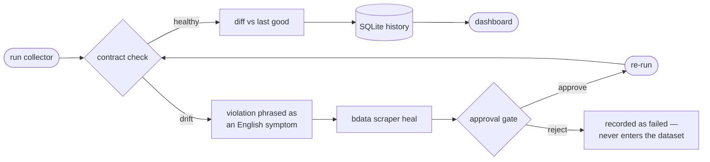
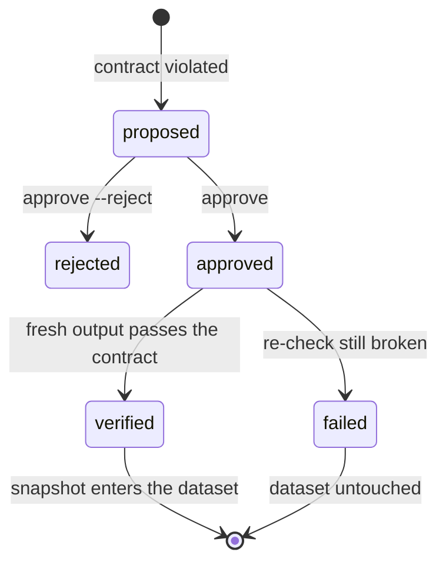

<div align="center">

# Dr Browser

**The self-healing doctor for AI-infrastructure changelogs.**

It detects silent extraction drift, heals the *same* Bright Data Collector ID,
and only trusts a repair after fresh output passes its original contract.

[](https://www.python.org/)
[](#engineering-quality)
[](https://github.com/astral-sh/ruff)
[](https://mypy-lang.org/)
[](https://brightdata.com/products/scraping-automation/scrapers-browser-api)
[](LICENSE)

*Built for the [Scrape-Verse Hackathon](https://wemakedevs.org).*

[▶ Watch the 58-second product demo](demo/dr-browser-demo.mp4)

</div>

---

Most scraping projects end when the scraper runs. This one is designed around
what happens when it **breaks** — because that is the part that actually
decides whether a data pipeline survives contact with the real web.

## Review it in five minutes

The repository is self-contained: the synthetic demo makes the complete
dashboard reviewable without credentials, while the live collection history is
kept separately and labelled as such.

```bash
uv sync
uv run python scripts/seed_demo.py --db data/demo.db --output site/index.html
```

Open `site/index.html` to see the product story end to end: a healthy
collection, an intentionally drifted field, the English repair symptom, a
verified re-run, and the resulting change feed. The page is visibly marked
**SYNTHETIC DEMO DATA** so it cannot be mistaken for live evidence.

For the actual Bright Data result, see
[`docs/live-recovery.md`](docs/live-recovery.md). It records the collector IDs,
fresh row counts, and current contract outcomes without overstating an
unverified repair.

After pushing to GitHub and enabling Pages for the repository, the included
scheduled workflow publishes the live dashboard at the repository's GitHub
Pages URL. Add the submitted demo-video URL here once it is recorded; this
repository deliberately does not claim a video that has not been published.

The dashboard opens with the symptom the pipeline wrote about itself and the
recovery that followed, then shows, per target: a bar per stored collection,
and a **contract gauge** for every field — the measured fill rate drawn against
the floor it has to clear, with pattern and distinctness clauses on their own
scales beneath it. Below that sit the recovery log (symptom, the exact prompt
sent to Bright Data, outcome), the change feed, and the contracts as declared.

> Its synthetic preview is clearly labelled; only a live collection and a
> verified recovery count as production evidence.
> [`docs/live-recovery.md`](docs/live-recovery.md) records exactly where that
> line sits today.

## The idea

A scraper almost never fails loudly. The site gets redesigned, a class name
changes, and the collector keeps returning rows — just with `price` silently
null, or `date` quietly holding the words `"Read more"`. Downstream, nothing
errors. The dataset just rots.

Dr Browser makes that failure mode **detectable**, and then **repairable
without human intervention**:



### Every target declares a contract

The contract says how often each field must be populated and what its values
should look like. When a field drifts, the same contract that detected the
break writes the repair prompt — in English, not error codes:

```toml
[[targets.fields]]
name = "date"
min_fill_rate = 0.85
pattern = "\\d{4}"
description = "the publication date, containing a four-digit year"
```

When that field drifts, the pipeline sends Bright Data this, verbatim:

> The `date` field no longer looks like the publication date, containing a
> four-digit year — 100% of values fail the expected pattern `\d{4}`.
> Examples: 'Read more', 'Read more', 'Read more'. The selector is probably
> picking up a neighbouring element.

Then it re-runs the healed collector and **re-checks it against the same
contract**:



A heal only counts as `verified` if fresh output passes. An accepted-but-wrong
fix is recorded as `failed` and never enters the dataset.

## What it watches

Four AI-infrastructure changelogs, deliberately chosen from the long tail —
none of them have a pre-built Bright Data scraper:

| target | source |
|---|---|
| `langchain` | <https://changelog.langchain.com/> |
| `anthropic-api` | <https://docs.claude.com/en/release-notes/api> |
| `runpod-docs` | <https://docs.runpod.io/changelog> |
| `ollama` | <https://ollama.com/blog> |

All public pages. No logins, no paywalls, no personal data.

## Quickstart

```bash
uv sync                                    # install
bdata login                                # authenticate (interactive, once)

uv run dr-browser init                     # write targets.toml with contracts
uv run dr-browser provision                # create collectors (5-10 min each)

uv run dr-browser pull                     # run + check + heal + diff
```

Preview the dashboard without an account or credentials — the demo database is
clearly marked synthetic:

```bash
uv run python scripts/seed_demo.py --db data/demo.db
```

### When something breaks

```bash
uv run dr-browser pull                     # detects drift, proposes a fix, stops at the gate
uv run dr-browser approve langchain        # accept -> re-runs -> re-checks -> verified
uv run dr-browser approve langchain --reject   # or discard and try a sharper prompt
```

Add `--auto-approve` to close the loop with no human in it — that is the mode
CI runs in.

### Command reference

| command | what it does |
|---|---|
| `dr-browser init` | write a starter `targets.toml` with contracts already filled in |
| `dr-browser provision` | create Scraper Studio collectors for targets without one |
| `dr-browser inspect` | run a collector and report the schema it actually returns |
| `dr-browser pull` | collect every target, healing any whose output has drifted |
| `dr-browser status` | show each target's collector, contract, and collection history |
| `dr-browser heal` | re-check a target and ask Scraper Studio to fix it if broken |
| `dr-browser approve` | approve (or `--reject`) a heal waiting at the approval gate |
| `dr-browser diff` | what changed on recent collections |
| `dr-browser report` | render the dashboard: change feed plus the recovery timeline |

## How it maps to Bright Data

| Dr Browser | Bright Data |
|---|---|
| `dr-browser provision` | `bdata scraper create <url> "<description>"` |
| `dr-browser pull` | `bdata scraper run <collector_id> <url>` |
| contract violation → symptom | `bdata scraper heal <collector_id> "<prompt>"` |
| `dr-browser approve` | `bdata scraper approve <collector_id> [--reject]` |

The Collector ID is the stable interface. Healing mutates the scraper in place,
so **no downstream code changes when a site changes** — the contract, the diff
engine, the store, and the dashboard are all untouched by a repair.

## Architecture

```
src/scrapverse/
  config.py      targets + field contracts (the tripwire, as configuration)
  brightdata.py  typed wrapper over the bdata CLI, injectable runner
  health.py      contract checking -> violations phrased as heal prompts
  heal.py        the repair loop: heal -> approve -> re-run -> re-verify
  diff.py        snapshot diffing by stable row identity
  store.py       SQLite history of snapshots, diffs, heal events
  pipeline.py    the whole cycle in one readable function
  report.py      self-contained HTML dashboard
  cli.py         typer CLI, one command per pipeline stage
```

`pipeline.pull()` is the whole product in one function — every other module is
a seam it composes.

## Engineering quality

Every Bright Data call goes through an injectable `CommandRunner`, so the full
pipeline — including the break-detect-heal-verify path — is tested without a
network, an account, or the 5-to-10-minute AI generation wait.

```bash
uv run pytest                              # 90 tests, no network or credentials needed
uv run ruff check . && uv run ruff format --check .
uv run mypy src/scrapverse                 # strict mode
```

## Continuous collection

`.github/workflows/collect.yml` runs the pipeline on a schedule with
`--auto-approve`, commits the refreshed store, and publishes the dashboard to
GitHub Pages. Authentication uses `BRIGHTDATA_API_KEY` rather than the
interactive login, so the loop closes with nobody watching.

## Licence

[MIT](LICENSE) © Aditya Sasidhar.
